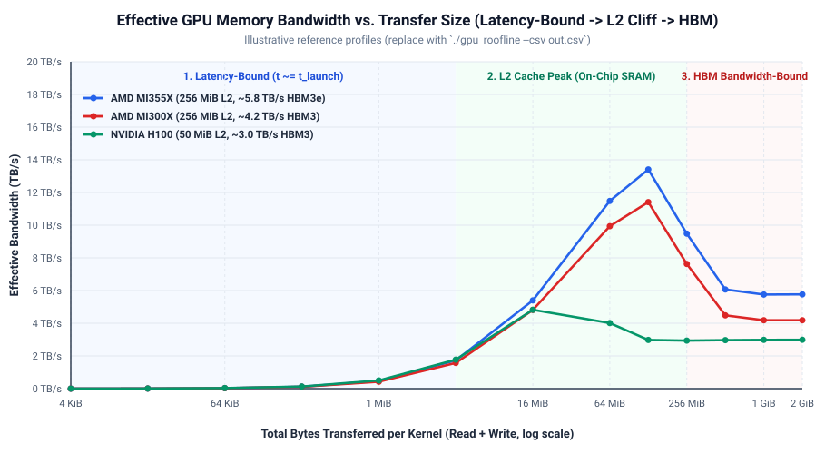

# `gpu-roofline` — Empirical LLM Inference Roofline Probe (CUDA & ROCm)

A zero-dependency C++ suite that empirically measures **every hardware ceiling that governs LLM inference**—across both **NVIDIA GPUs (`nvcc`)** and **AMD Instinct GPUs (`hipcc`: MI250X `gfx90a`, MI300X `gfx942`, MI355X `gfx950`)**—in ~3 seconds.

---

## Why Does This Exist? (What NVIDIA & AMD Ship Natively)

Datasheet specs (*"8 TB/s HBM, 2.5 PFLOP/s BF16"*) rarely match the **achievable** ceilings your kernels actually experience. Both vendors ship official tools, **but they are fragmented across half a dozen single-vendor utilities**:

| What you want to measure | NVIDIA native tool | AMD ROCm native tool | Gap in stock vendor tools |
|---|---|---|---|
| **PCIe & P2P (`NVLink` / `xGMI`)** | `nvbandwidth`, `p2pBandwidthLatencyTest` | `rocm-bandwidth-test`, `TransferBench` | Host/Fabric DMA only—no L2, LDS/SMEM, compute, or launch floor |
| **HBM / L2 / Shared-Mem rooflines** | `ncu --set roofline` (Nsight Compute) | `rocprof-compute` (`omniperf`) | Heavyweight Python/profiler suites; meant to profile an existing app, not print a quick card sanity check |
| **Tensor / Matrix Core TFLOP/s** | `cutlass_profiler` | `hipblaslt-bench` | Separate multi-GB library build |
| **Eager vs Graph launch latency** | *(no standard built-in CLI)* | *(no standard built-in CLI)* | Critical for `bs=1..8` LLM decode & speculative decoding |

`gpu-roofline` puts **all eight ceilings + a `4 KiB -> 2 GiB` Latency-to-Bandwidth sweep + the derived LLM Batch-Size Ridge Point** into one ~300-line C++ binary that compiles out of the box on both CUDA and ROCm.

---

## Quickstart (MI300X, MI355X, H100, B200, RTX)

```bash
make              # Auto-detects nvcc (NVIDIA) or hipcc (AMD gfx942 + gfx950 fat binary)
./gpu_roofline --csv mi355x.csv

# Build and run the 5 step-by-step learning exercises:
make exercises
./exercises/01_hbm_coalescing
./exercises/02_cache_and_shared_mem
./exercises/03_valu_vs_matrix_cores
./exercises/04_launch_floor_and_graphs
./exercises/05_pcie_and_p2p_links

# Overlay multiple GPUs (e.g. MI300X vs MI355X) into a single SVG chart:
python3 scripts/plot_sweep.py mi300x.csv mi355x.csv -o comparison.svg
```

---

## Latency-Bound vs. Bandwidth-Bound: Why Transfer Size Changes Everything

A GPU never runs at a single fixed "memory bandwidth." Every kernel transfer of `B` bytes obeys:

```text
Total Time(B)  ~=  t_launch  +  B / BW_effective(B)
Achieved BW(B)  =  B / Total Time(B)
```

Sweeping `B` from `4 KiB` to `2 GiB` (`./gpu_roofline` prints an ASCII chart in your terminal and exports CSV for `scripts/plot_sweep.py`) exposes **three distinct regimes**:



1. **Regime 1 — Latency-Bound (`4 KiB` – `~2 MiB`):**
   Moving `4 KiB` takes `~2.2 µs`—almost the exact same time as moving `64 KiB` (`~2.3 µs`)! Why? Because `t_launch` (`~2 µs` of GPU dispatch + pipeline fill latency) dwarfs the actual wire transfer time (`64 KiB / 18 TB/s = 0.0035 µs`). Tiny per-token ops (`bs=1` norms, sampling, RoPE, tiny `AllReduce`s) live here: **more GB/s on the datasheet does zero good unless you fuse kernels or capture CUDA/HIP Graphs**.
2. **Regime 2 — On-Chip L2 Cache Peak (`~16 MiB` – `~200 MiB` on MI300X/MI355X; `~8–40 MiB` on H100):**
   The payload is finally large enough to amortize `t_launch`, *and* small enough to stay 100% inside the GPU's on-chip L2 SRAM (`50 MiB` on H100, `256 MiB` on MI300X/MI355X). Bandwidth surges to **`12–20 TB/s`** (`3x` faster than HBM!). Hot shared MoE experts, draft-model layers, and tile-reused activations live here.
3. **Regime 3 — HBM Bandwidth Plateau (`>= 512 MiB`, past the L2 Cliff):**
   Once working-set bytes exceed L2 capacity, cache lines evict before reuse and throughput drops onto the flat off-chip **HBM plateau** (`~3.0 TB/s` H100, `~4.2–4.5 TB/s` MI300X, `~5.8–6.2 TB/s` MI355X). Streaming multi-gigabyte LLM weights and long-context KV caches lives here.

---

## File-by-File Guide

| File | Lines | What It Does & What You Learn From Reading It |
|---|---:|---|
| [`gpu_compat.h`](gpu_compat.h) | ~75 | **Cross-vendor translation layer.** Maps `cudaMalloc` / `hipMalloc`, events, streams, graphs, and wavefront size (`32` on NVIDIA warps vs `64` on AMD CDNA waves) onto a single `gpu*` API so every file compiles unmodified on `nvcc` and `hipcc`. |
| [`gpu_roofline.cpp`](gpu_roofline.cpp) | ~315 | **All-in-one empirical probe.** Runs all 8 benchmarks (`[1a/b]` Coalesced vs Strided HBM, `[2]` L2, `[3]` Shared/LDS, `[4]` FP32 VALU, `[5]` BF16 WMMA/MFMA Matrix Cores, `[6a/b/c]` CPU vs Eager vs Graph launch floor, `[7]` PCIe, `[8]` P2P `NVLink`/`xGMI`), prints the `4 KiB -> 2 GiB` ASCII regime chart, optionally saves `--csv`, and computes the **LLM Batch-Size `M` Ridge Point**. |
| [`exercises/01_hbm_coalescing.cpp`](exercises/01_hbm_coalescing.cpp) | ~75 | **Pointers & Memory Coalescing.** Compares `float` (`32-bit`), `float4` (`128-bit` vectorized), and `stride-33` uncoalesced reads. Shows why contiguous lanes in a warp/wave must read adjacent bytes so the memory controller can merge requests into full `128-byte` HBM cache lines instead of wasting `~90%` of bus bandwidth. |
| [`exercises/02_cache_and_shared_mem.cpp`](exercises/02_cache_and_shared_mem.cpp) | ~75 | **L2 Cliff & CU/SM Shared Memory (`__shared__` / LDS).** Sweeps array sizes from `4 MiB` up to `1024 MiB` so you can watch bandwidth fall off a `~3x` cliff the exact moment bytes exceed `prop.l2CacheSize`, then benchmarks per-SM/CU scratchpad SRAM (`40–100+ TB/s`)—the exact memory FlashAttention uses to avoid writing `N x N` attention matrices to HBM. |
| [`exercises/03_valu_vs_matrix_cores.cpp`](exercises/03_valu_vs_matrix_cores.cpp) | ~90 | **Pipeline Latency, ILP, & Matrix/Tensor Cores.** Runs three compute kernels back-to-back: (1) a single dependent FMA chain `c = a*c + b` (stalls `~75%` of cycles waiting on 4-cycle ALU latency), (2) 8 independent FMA chains (`c0..c7` hitting `100%` Vector ALU peak via instruction-level parallelism), and (3) hardware **BF16 Matrix/Tensor Cores** (`wmma` / `mfma`, jumping another **`8–16x`** in TFLOP/s). |
| [`exercises/04_launch_floor_and_graphs.cpp`](exercises/04_launch_floor_and_graphs.cpp) | ~80 | **Async Streams, Launch Overhead, & CUDA/HIP Graphs.** Separates what the CPU pays (`~1–3 µs` to drop a packet into a ring buffer) from the GPU's eager launch floor (`~2–5 µs`), then captures a 1,000-kernel chain into a **CUDA/HIP Graph** to slash inter-kernel dead air down to `~0.3–0.8 µs`. |
| [`exercises/05_pcie_and_p2p_links.cpp`](exercises/05_pcie_and_p2p_links.cpp) | ~80 | **Off-Chip Links: Pageable vs Pinned PCIe & Multi-GPU P2P.** Demonstrates why `malloc()` pageable host memory crawls over PCIe (`~10–20 GB/s` due to CPU staging copies), why page-locked `gpuHostMalloc` unlocks the full PCIe DMA engine (`~50–60 GB/s`), and how `gpuDeviceEnablePeerAccess` lets GPU 0 read GPU 1's HBM directly over `NVLink` / `xGMI` (`300–450+ GB/s`). |
| [`scripts/plot_sweep.py`](scripts/plot_sweep.py) | ~140 | **Zero-dependency SVG plotter.** Takes any number of CSV sweeps (`./gpu_roofline --csv mi300x.csv`, `mi355x.csv`, `h100.csv`) and renders a clean multi-GPU log-scale bandwidth curve highlighting the Latency-Bound, L2 Peak, and HBM Plateau zones. |

---

## Walkthrough: How Data Moves Through a GPU During LLM Inference

Suppose an HTTP request arrives with a **4,096-token prompt**, and the LLM (`L = 60` Transformer layers) generates tokens one by one. Here is the physical path every byte travels—and how every exercise in this repo maps onto a real stage of the forward pass:

```text
  Host CPU RAM ──(PCIe ~55 GB/s [7])──► GPU HBM (~3–8 TB/s [1a])
                                               │
                         ┌─────────────────────┴─────────────────────┐
                         ▼ (Weights, KV Cache, Residual Stream)      ▼
                On-Chip L2 Cache (~12–20 TB/s [2], 50–256 MiB)   NVLink / xGMI P2P [8]
                         │                                       (TP AllReduce / MoE All2All
                         ▼                                        ~300–900 GB/s across GPUs)
           SM / CU Shared Memory / LDS (~40–100+ TB/s [3], 64–256 KiB/CU)
                         │
                         ▼
               Vector & Matrix Registers (VGPR / AGPR, >300 TB/s)
                    ├──► Vector ALUs [4]  (RMSNorm, RoPE, Softmax exp(), SiLU/SwiGLU)
                    └──► Tensor / Matrix Cores [5]  (QKV, Attn Q*K^T & P*V, O-proj, FFN/MoE)
```

### Phase A — Prefill (Processing All `M = 4,096` Prompt Tokens at Once)

1. **Token IDs cross PCIe (`[7]`):** The CPU copies `4,096` integers (`16 KiB`) from pinned host RAM over PCIe into GPU HBM (`< 5 µs`). Embedding lookup gathers `4,096` vectors (`[4096, D]`) in HBM.
2. **RMSNorm (`[1a]` + `[4]`):** Each block loads one token's row (`D` elements) from HBM $\to$ L2 $\to$ Registers, computes sum-of-squares across threads via Shared Memory/Warp Shuffle (`[3]`), normalizes on **Vector ALUs (`[4]`)**, and writes normalized activations out—or fuses this directly into the next GEMM!
3. **Linear / MoE Projections (`Q, K, V, O, Gate, Up, Down` — `[1a]` + `[2]` + `[5]`):**
   * The GPU streams weight tiles `W` from **HBM (`[1a]`)** through **L2 (`[2]`)** into **Shared Memory / LDS (`[3]`)** and **Registers**.
   * Crucially, **each weight byte loaded from HBM is reused across all `M = 4,096` prompt tokens!**
   * Arithmetic intensity is `~2 * M = 8,192 FLOPs / weight-byte`—well **above** the GPU's Ridge Point (`~250–650 FLOPs/Byte`). HBM easily keeps up, and **Matrix/Tensor Cores (`[5]`)** are **compute-bound** near peak TFLOP/s!
4. **FlashAttention (`[3]` + `[4]` + `[5]`):**
   * Instead of writing a giant `[4096 x 4096]` score matrix back to HBM, each CU/SM pins a tile of `Q` in **Shared Memory / Registers (`[3]`)** and streams tiles of `K` and `V` through LDS:
     * `S = Q * K^T` runs on **Matrix Cores (`[5]`)**.
     * Online row-max & `exp(S - m)` rescaling runs on **Vector ALUs (`[4]`)** *entirely inside registers*.
     * `O += P * V` runs on **Matrix Cores (`[5]`)**.
   * Fresh `K` and `V` tensors are written once to the **Paged KV Cache in HBM (`[1a]`)** so future decode steps never recompute them.
5. **Multi-GPU Communication (`[8]`):** Under Tensor Parallelism (`TP=2/4/8`), each layer's `O-proj` and `Down-proj` produce partial sums on each GPU, triggering an **AllReduce** across **NVLink / xGMI (`[8]`)**.

### Phase B — Autoregressive Decode (`M = 1` New Token per Request!)

Now the prompt is finished and the user is waiting for token `#4,097`, then `#4,098`, one after another:

1. **The Arithmetic Intensity Collapse (`[1a]` vs `[5]`):**
   * For a single user (`M = 1`), computing `y = x * W` STILL has to read **100% of the active model weights `W` from HBM**, just to perform `2 FLOPs` per weight parameter (`1 FLOP/Byte` in BF16, `2 FLOPs/Byte` in FP8, `4 FLOPs/Byte` in FP4)!
   * Compare `1–4 FLOPs/Byte` against your GPU's Ridge Point (`~300–650 FLOPs/Byte`): **Matrix Cores sit >98% idle waiting on HBM wires!** Single-stream decode speed is strictly `Active Weight Bytes + KV Cache Bytes` divided by **HBM Bandwidth (`[1a]`)**.
2. **Paged KV-Cache Reads (`[1a]` + `[1b]`):**
   * At context length `32k–128k`, Decode Attention only has `1` query token (`Q` is a single vector!), yet it must stream tens of megabytes of historical `K` and `V` pages out of HBM. If page gathers aren't vectorized/coalesced (`[1b]`), HBM efficiency tanks.
3. **The Kernel Launch Wall (`[6b]` vs `[6c]`):**
   * Across 60 layers, one decode step launches **300–500 tiny kernels**. At `bs = 1`, many kernels execute in `3–8 µs` on the GPU. If eager launch overhead (`[6b]`) adds `3–4 µs` of dead air per kernel, **`30–50%` of total token latency is empty gap between kernels!** Capturing the decode step into **CUDA/HIP Graphs (`[6c]`)** and fusing ops (`RMSNorm + Quant + GEMM`, `AllReduce + RMSNorm`) eliminates that dead air.

---

## How to Navigate LLM Inference Today (And Which Bottlenecks Still Exist)

Whenever you profile or optimize an inference workload, ask **one question first**: *"Which of the 4 physical walls am I hitting right now?"*

| Wall | Symptom | How to Check in `gpu_roofline` | Lever That Actually Moves the Needle |
|---|---|---|---|
| **1. HBM Weight-Bandwidth Wall** *(low-batch decode)* | High ITL (`ms/token`) at `bs=1..16`, low SM/CU compute utilization | Compare `Active Weight Bytes / ITL` vs `[1a] HBM TB/s` | Weight quantization (`BF16 -> FP8 -> MXFP4/NVFP4`), MoE sparsity, **Speculative Decoding (`M=1 -> M=4..6` draft+verify tokens per weight read!)** |
| **2. HBM KV-Cache Wall** *(long-context decode)* | Decode slows linearly past `32k–128k` context or concurrent batch shrinks | KV bytes read per step approaches/exceeds active weight bytes | `MLA` / `GQA` (shrinking KV head state), `FP8`/`FP4` KV cache, hybrid Sliding-Window + Global attention, Sparse/Top-K KV Indexers |
| **3. Launch & Synchronization Wall** *(small batch / Python host)* | Profiler trace shows gaps between short kernels | `N_kernels * [6b] Eager Floor` is a big slice of step time | `CUDA/HIP Graphs` (`[6c]`), megakernel / monokernel fusion, persistent kernels, overlap schedules |
| **4. Multi-GPU Fabric Wall** *(`TP` AllReduce / `EP` All-to-All)* | Scaling `1 -> 2 -> 8` GPUs yields `< 1.5x` per doubling | Compare message size against `[8] P2P Bandwidth` & latency regime | Custom one-shot `AllReduce + RMSNorm` kernels (`<=256 KiB` latency-bound), `NVLink`/`xGMI`-aware `All-to-All` (`DeepEP` / `MORI`), Two-Batch Overlap (`TBO`) |

### The 6 Biggest Open Bottlenecks in LLM Inference Right Now

Even on state-of-the-art serving engines (`SGLang`, `vLLM`, `TensorRT-LLM`), these problems remain active frontiers:

1. **Breaking the `M = 1` HBM Wall via Speculative Decoding at Long Context & Agentic Tool Use:**
   Speculative decoding (EAGLE-3, MTP, Medusa) turns 1 weight read (`M=1`) into `3.5–5` accepted tokens (`M=4..8` verify batch—essentially `3x` free HBM bandwidth!). *Open problem:* Draft models suffer acceptance drop-offs out-of-distribution (100k+ long context, heavy multi-turn code/JSON tool calls) and add their own launch + KV overhead if not tightly fused.
2. **MoE Decode `All-to-All` Latency vs. High-Batch Expert Parallelism (`EP`):**
   Modern frontier models are sparse MoEs (e.g., `256–512` routed experts, `top-8` active). At huge concurrency (`bs >= 128`), sharding experts across 8–64 GPUs (`EP`) wins massively; at interactive concurrency (`bs = 1..32`), cross-GPU `All-to-All` dispatch/combine hits **Regime 1 (Latency-Bound)** and loses to simple `TP=2/4` unless communication is overlapped with compute (`Two-Batch Overlap` / `Symmetric Memory` P2P kernels).
3. **Sub-Quadratic / Sparse Attention Without Quality Loss at `128k–1M+` Context:**
   Dense prefill scales as `O(N^2)` Matrix-Core FLOPs, and dense decode KV traffic scales as `O(N)` HBM bytes. Hardware-friendly sparse attention (learned FP4/FP8 lightning indexers, block-sparse paged KV, hybrid linear/Mamba/Gated-DeltaNet + full attention) is still fighting kernel launch fragmentation and subtle retrieval regressions.
4. **Dynamic Shapes vs. Rigid `CUDA/HIP Graphs`:**
   Graphs (`[6c]`) require fixed tensor addresses and grid shapes, whereas real serving has variable ragged token counts, speculative verify trees, and dynamic MoE routing counts. Piece-wise / breakable graphs and persistent megakernels are actively replacing brittle bucketed graph capture.
5. **Low-Precision (`MXFP4` / `NVFP4`) Activation Outliers & Tiny-Tile Efficiency:**
   4-bit microscaling cuts HBM weight traffic in half vs FP8, *but* `M = 1..16` skinny GEMMs (`gemv` / grouped MoE GEMMs) often achieve only `40–65%` of raw HBM bandwidth due to scale-factor unpack overhead, unaligned tile padding, and dynamic per-block activation quantization kernels.
6. **Prefill–Decode (`PD`) Disaggregation & KV-Cache Network Transfer:**
   Running compute-bound Prefill (`Regime: Matrix Cores`) and bandwidth-bound Decode (`Regime: HBM`) on the same GPU causes prefill chunks to spike decode Inter-Token Latency (`ITL`). Splitting Prefill and Decode onto separate GPU pools solves interference, *but* turns RDMA (`InfiniBand` / `RoCE`) KV-cache transfer + Prefix-Cache routing into the new systems bottleneck.

---

## License

MIT
